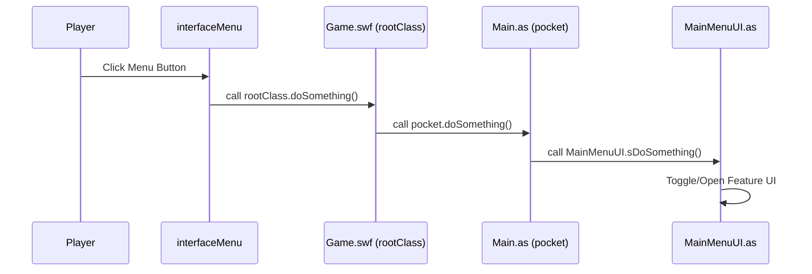

# Your Hero Menu Customization Guide (you-mad-bro)

Technical reference and operational workflow for modifying the **"Your Hero"** popup menu (the menu that appears when clicking the hero helmet icon on the bottom navigation bar) in the `you-mad-bro` AQW client wrapper.

---

## 1. Architectural Overview

The "Your Hero" menu is built through the interplay of AVM2 bytecode (`Game.swf`) and ActionScript 3 in the host loader (`Loader.swf`):

1. **`spider_fla.charicon_322`** (and related `Symbol23copy_*` symbols):
   - The MovieClip representing the hero button on the bottom bar.
   - Its `frame1()` method initializes the `buttons` Array defining all menu items.
2. **`interfaceMenu`**:
   - The class responsible for visually rendering the popup menu upward from the bottom bar.
   - Reads the `txt` property for the button label and the `fct` property for the action executed on click.
3. **`Game.swf` (`rootClass`)**:
   - The root timeline of the AQW client. Holds references to `world` and the host bridge property `pocket` (reference to `Main.as`).
4. **`loader/src/Main.as` & `loader/src/input/MainMenuUI.as`**:
   - The host application layer that manages bot features and modal dialogs (Bot Manager, Quest Tree, Cell Jump, Auto Battle, Hide Players, etc.).

---

## 2. Critical Rule: Visual Screen Order vs. Array Index Order

Inside `interfaceMenu.class.asasm`, the popup menu is constructed **from the bottom up**:

- **Index `0`**: **BOTTOM-MOST** item (rendered directly above the bottom bar button, using `menuBottom` skin).
- **Index `1` to `N - 2`**: Items stacked consecutively upwards (`menuListItem`).
- **Index `N - 2`**: **TOP-MOST** clickable item (rendered directly below the header title).
- **Index `N - 1`**: **MENU HEADER** (object with `txt: "Your Hero"`, rendered at the very top using `menuTop` skin).

> [!IMPORTANT]
> **To add items at the very top**: Place them at higher array indices (immediately before the header).
> **To add items at the very bottom**: Place them at index `0` or `1`.

### Screen Representation vs. ASASM Array Mapping:
```text
Screen Display (Top to Bottom)       ASASM Array Index
┌─────────────────────────┐
│ Your Hero               │ ◄─────── Index 13 (Header: txt = "Your Hero")
├─────────────────────────┤
│ Bot Manager             │ ◄─────── Index 12 (Top-most clickable button)
├─────────────────────────┤
│ Loader / Grabber        │ ◄─────── Index 11
├─────────────────────────┤
│ Cell Jump               │ ◄─────── Index 10
├─────────────────────────┤
│ Bank                    │ ◄─────── Index 9
├─────────────────────────┤
│ Outfits                 │ ◄─────── Index 8
├─────────────────────────┤
│ Guild                   │ ◄─────── Index 7
├─────────────────────────┤
│ Friends                 │ ◄─────── Index 6
├─────────────────────────┤
│ Friendships             │ ◄─────── Index 5
├─────────────────────────┤
│ Reputations             │ ◄─────── Index 4
├─────────────────────────┤
│ Class Overview          │ ◄─────── Index 3
├─────────────────────────┤
│ Stats Overview          │ ◄─────── Index 2
├─────────────────────────┤
│ Hide Players            │ ◄─────── Index 1
├─────────────────────────┤
│ Auto Battle             │ ◄─────── Index 0 (Bottom-most item)
└─────────────────────────┘
```

---

## 3. Action Dispatch Resolution (`fct`)

When a menu button is clicked, `interfaceMenu.onClick()` splits the `fct` string by periods (`.`):

1. **Length 1** (e.g., `"charPage"`):
   - Invokes: `this[name]()`
2. **Length 2** (e.g., `"rootClass.openBotManager"`):
   - Invokes: `rootClass[name.split(".")[1]]()` ➔ calls method on the `Game` instance.
3. **Length 3** (e.g., `"rootClass.world.toggleBank"`):
   - Invokes: `rootClass.world[name.split(".")[2]]()` ➔ calls method on `rootClass.world`.

---

## 4. Communication Pattern: Game.swf ➔ Loader (Pocket Bridge)

Because `Game.class.asasm` is a `SEALED` class without the `flash.events` package in its default scope, **DO NOT** use `dispatchEvent(new Event(...))`. Doing so will trigger:
```
ReferenceError: Error #1065: Variable Event is not defined
```

### Standard Solution: Use the `pocket` Bridge
The host loader stores a reference to itself at `gameMovieClip.pocket = this;` in [Main.as](file:///Users/d/Documents/you-mad-bro/loader/src/Main.as).

Invocation Flow:


---

## 5. Step-by-Step Workflow to Add / Edit Menu Items

### Step 1: Implement the Feature in `MainMenuUI.as`
Open [loader/src/input/MainMenuUI.as](file:///Users/d/Documents/you-mad-bro/loader/src/input/MainMenuUI.as):
1. Ensure the method is `public`:
   ```actionscript
   public function myNewFeature():void {
       // UI feature logic
   }
   ```
2. Add a static delegate helper:
   ```actionscript
   public static function sMyNewFeature():void {
       if (instance != null) instance.myNewFeature();
   }
   ```

### Step 2: Add the Bridge Method in `Main.as`
Open [loader/src/Main.as](file:///Users/d/Documents/you-mad-bro/loader/src/Main.as) and expose the public method on the `Main` class:
```actionscript
public function myNewFeature():void {
    MainMenuUI.sMyNewFeature();
}
```

### Step 3: Register the Method in `patcher/Patcher.java`
Open [patcher/Patcher.java](file:///Users/d/Documents/you-mad-bro/patcher/Patcher.java):
1. Add the method name to the `customPocketMethods` array:
   ```java
   String[] customPocketMethods = {"openBotManager", "openQuestTree", "openCellJump", "toggleAutoBattle", "doHidePlayers", "myNewFeature"};
   ```
   *The patcher will automatically generate AVM2 bytecode in `Game.class.asasm` that safely checks `pocket != null` and invokes `pocket.myNewFeature()`.*

2. In the `patchHeroButtonClass` method:
   - Insert the new button definition into `newButtons`:
     ```java
     + "      pushstring          \"txt\"\n"
     + "      pushstring          \"My New Feature\"\n"
     + "      pushstring          \"fct\"\n"
     + "      pushstring          \"rootClass.myNewFeature\"\n"
     + "      newobject           2\n"
     ```
   - Update the array count in `constructprop Multiname("Array", ...), <COUNT>`.
   - Ensure `maxstack` for `frame1` is at least `30` (or `35` if more items are added).

### Step 4: Build and Verify
Run the build script:
```bash
bash scripts/build-game.sh
```
This script will:
1. Run `Patcher.java` to patch the `Game.swf` bytecode.
2. Copy the patched game files into `loader/gamefiles/`.
3. Automatically compile `loader/Loader.swf` using `amxmlc`.

---

## 6. Current Menu Layout & Handlers Reference

| Visual Position | Button Label | Target `fct` | End Handler |
| :--- | :--- | :--- | :--- |
| **Top 1** | Bot Manager | `rootClass.openBotManager` | `MainMenuUI.openBotManager()` |
| **Top 2** | Loader / Grabber | `rootClass.openQuestTree` | `MainMenuUI.openQuestTree()` |
| **Top 3** | Cell Jump | `rootClass.openCellJump` | `MainMenuUI.openCellJump()` |
| **Top 4** | Bank | `rootClass.world.toggleBank` | Native AQW Bank panel |
| **Middle** | Outfits | `rootClass.toggleOutfits` | Native AQW Outfits panel |
| **Middle** | Guild | `rootClass.world.showGuildList`| Native AQW Guild list |
| **Middle** | Friends | `rootClass.world.showFriendsList` | Native AQW Friends list |
| **Middle** | Friendships | `rootClass.showFriendshipUI` | Native AQW Friendship panel |
| **Middle** | Reputations | `rootClass.showFactionInterface` | Native AQW Faction list |
| **Middle** | Class Overview | `rootClass.toggleCharpanel` | Native AQW Class panel |
| **Middle** | Stats Overview | `rootClass.toggleStatspanel` | Native AQW Stats panel |
| **Bottom 2** | Hide Players | `rootClass.doHidePlayers` | `MainMenuUI.doHidePlayers()` |
| **Bottom 1** | Auto Battle | `rootClass.toggleAutoBattle` | `MainMenuUI.toggleAutoBattle()` |

---

## 7. Gotchas & Troubleshooting

1. **Buttons Clicked but Feature Does Not Open:**
   - Verify whether `Loader.swf` was recompiled. If an outdated `Loader.swf` is running, the bridge methods in `Main.as` do not exist.
   - Ensure the method name passed to `rootClass.<name>` exactly matches the public method in `Main.as`.
2. **Menu Disappears / Blank Screen on Click:**
   - Check `maxstack` in `frame1` of `charicon_322.class.asasm`. The default AQW value is only `13`. For 14+ items, `maxstack` must be set to at least `30`.
   - Ensure the array constructor `constructprop Multiname("Array", ...), <N>` matches the exact number of objects pushed.
3. **Character Page Button:**
   - If you ever need to restore the Character Page button, add:
     `txt: "Character Page"`, `fct: "charPage"` (length 1, calls local function in `interfaceMenu`).
